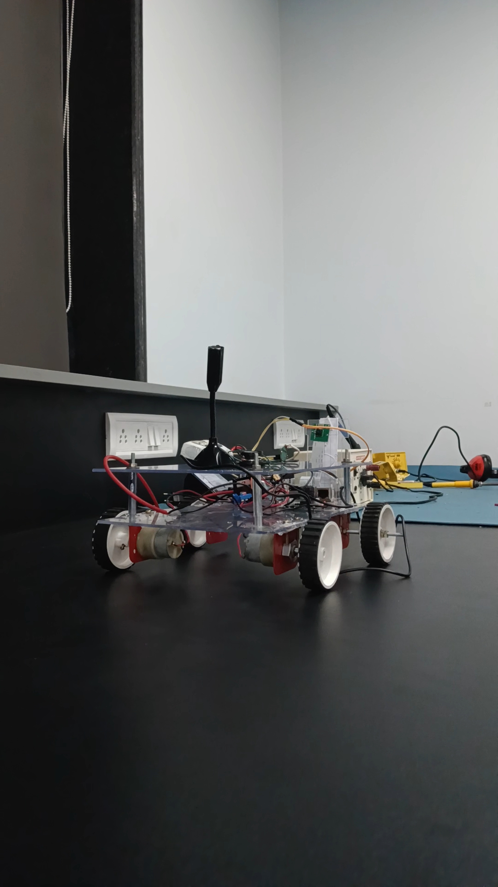
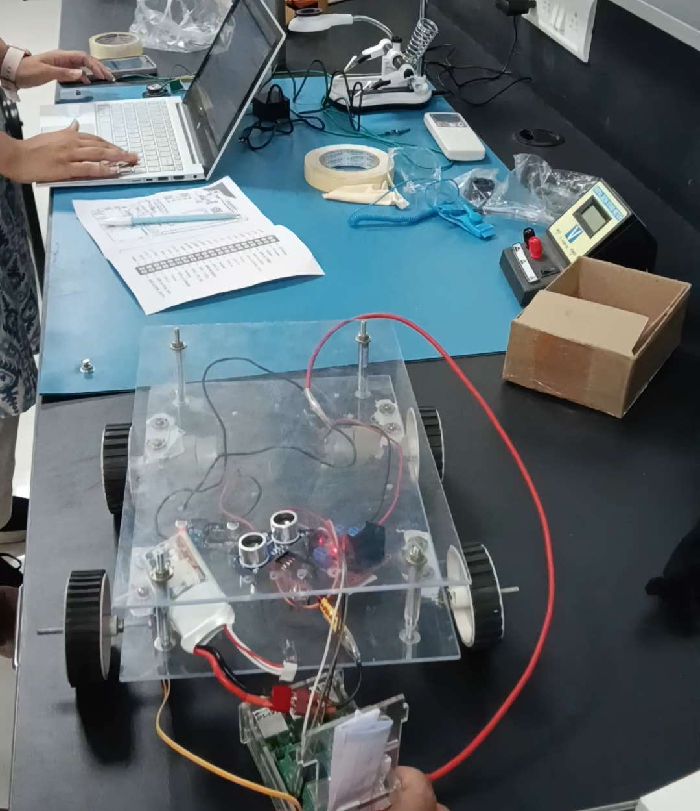
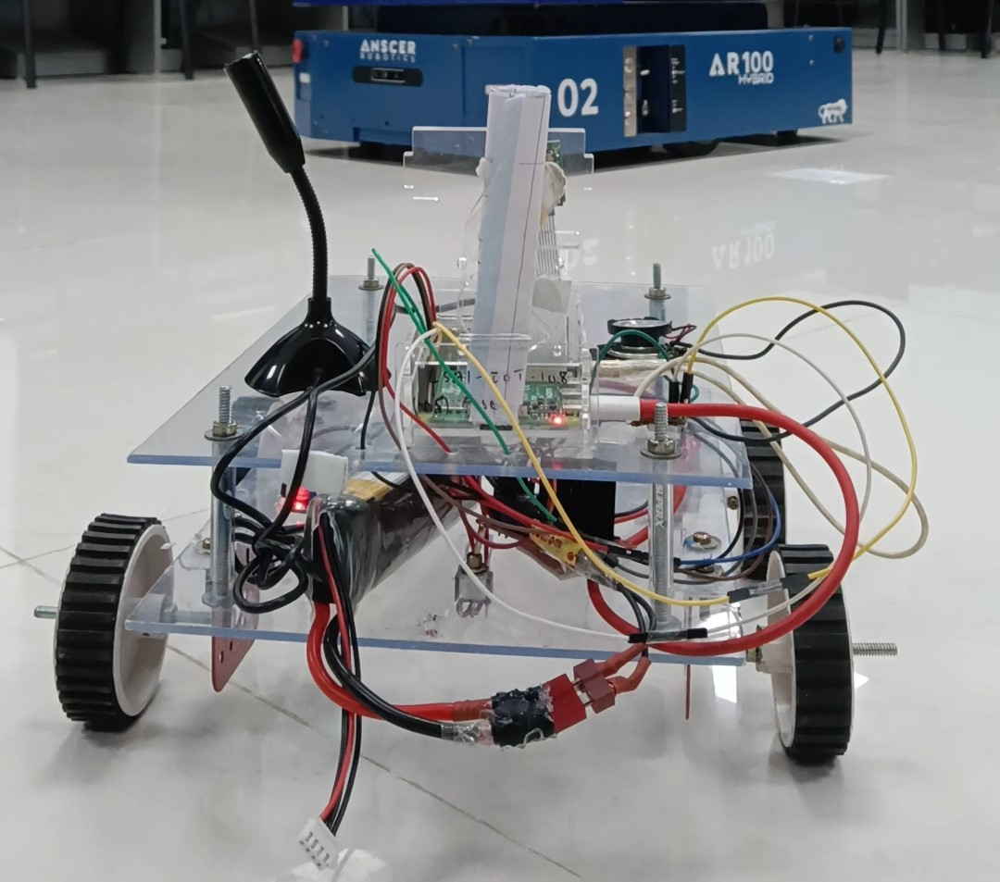

# Guide Robot 

An AI-powered indoor guidance robot built with Python, Raspberry Pi, computer vision, speech recognition, and autonomous motor control.

## Project Overview

The Department Guide Robot is designed to provide an interactive guideance experience through a combination of artificial intelligence, computer vision, voice interaction and robotic movement.

The system uses a camera to capture images, a deep-learning model to recognize different robots, and text-to-speech functionality to introduce the recognized robots.

The project is developed using a modular approach, with seperate components for image recognition, voice interaction and motor control, which were later integrated into final working prototype.


## Key Features

- Voice-based interaction
- Speech recognition and text-to-speech
- Camera-based computer vision
- Image recognition using a deep-learning model
- Motor control through Raspberry Pi
- Ultrasonic-sensor-based obstacle detection
- Modular integration of vision, speech, and movement


## Technologies

**Programming:** Python

**AI / Computer Vision:** TensorFlow,keras, OpenCV, MobileNetV2

**Voice:** SpeechRecognition, pyttsx3

**Hardware:** Raspberry Pi, camera, DC motors, motor driver, ultrasonic sensor

**Other:** NumPy, Pygame, GPIO

## Repository Structure

```text
guide-robot/
|
├── README.md
├── requirements.txt
├── .gitignore
|
├── notebooks/
│   ├── motor_driver.ipynb
|   
│   ├── camera_and_image_recognition.ipynb
│   ├── voice_interaction.ipynb
 department_guide_robot.ipynb
├── models/
│   
└── assets/
```

## Modules

### 1. Motor Control
`motor_driver.ipynb`

Contains the code responsible for controlling the robot's motors and movement through the Raspberry Pi.

### 2. Camera & Image Recognition
`camera_and_image_recognition.ipynb`

Handles camera input and image recognition using OpenCV and a MobileNetV2-based deep-learning workflow.

### 3. Voice Interaction
`voice_interaction.ipynb`

Implements speech recognition and text-to-speech functionality so the robot can receive and respond to voice commands.

### 4. Final Integrated System
`department_guide_robot.ipynb`

Combines the individual components into the complete Department Guide Robot system.

## Hardware

- Raspberry Pi
- Raspberry Pi camera / compatible camera
- DC motors
- Motor driver
- Ultrasonic sensor
- Robot chassis
- Power supply / buck converter

## Running the Project

This project was developed for a Raspberry Pi hardware environment.

1. Clone the repository.
2. Install the required Python packages.
3. Connect the required hardware.
4. Place any trained model files in the `models/` directory.
5. Run the relevant notebook or convert the final notebook into a Python script for deployment.

> Hardware-specific GPIO and camera functionality will not run correctly on a normal laptop without the required Raspberry Pi hardware.

## Projects Gallery








## Model Files

Large trained model files are intentionally not included in this repository. See `models/README.md` for guidance.

## Future Improvements

- Real-time indoor mapping and navigation
- SLAM-based navigation
- Improved obstacle avoidance
- Larger image-recognition dataset
- More natural voice interaction
- Web/mobile interface for destination selection

## Author

**Tanvi Singh Rathore**

B.Tech — Information Technology
